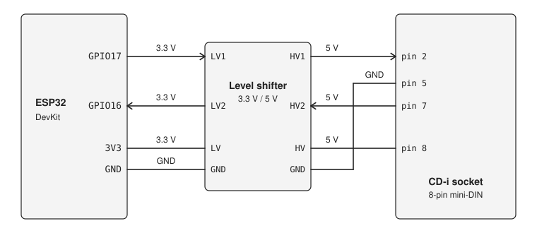

# ESP32 CD-i Controller

Arduino sketch that makes an ESP32 behave as a Philips CD-i joypad, so a Bluetooth gamepad plays a CD-i 450 wirelessly.

## Hardware

| Component                        | Function                                                                                                          |
|----------------------------------|-------------------------------------------------------------------------------------------------------------------|
| ESP32 DevKit (CP2102 USB serial) | Controller. This board is chip revision v0.0 (see Installation), blank MAC, Bluetooth address `00:00:00:00:00:02` |
| Level shifter, 3.3 V / 5 V       | Two channels: data to the player, ready line from the player                                                      |
| 8-pin mini-DIN plug              | Connects to the CD-i controller socket                                                                            |
| Bluetooth Controller             | Gamepad, in X mode                                                                                                |

The ESP32 is powered over USB, not from the CD-i. Pin 8 of the socket only feeds the level shifter's HV reference.

## Wiring



Socket pins, facing the console. The CD-i 450's single socket carries two controllers: pins 2 and 7 for one, pins 1 and 4 for the other. A plain controller uses 2 and 7.

| Pin     | Signal                          | Wired to                          |
|---------|---------------------------------|-----------------------------------|
| 2       | RXD2, the player's data input   | GPIO17 (TX2), through the shifter |
| 7       | RTS2, the player's ready line   | GPIO16, through the shifter       |
| 5       | GND                             | ESP32 GND                         |
| 3       | TXD, the player's own transmit  | Not connected                     |
| 8       | 5 V                             | Shifter HV reference only         |
| 1, 4, 6 | RXD1, RTS1, CTS1                | Not connected                     |

## Installation

1. Install [arduino-cli](https://arduino.github.io/arduino-cli/) and add the Bluepad32 board index:

```bash
arduino-cli config add board_manager.additional_urls https://raw.githubusercontent.com/ricardoquesada/esp32-arduino-lib-builder/master/bluepad32_files/package_esp32_bluepad32_index.json
arduino-cli core install esp32-bluepad32:esp32
```

2. Build and flash `cdi_pad`:

```bash
arduino-cli compile --fqbn esp32-bluepad32:esp32:esp32 cdi_pad
arduino-cli upload --fqbn esp32-bluepad32:esp32:esp32 -p /dev/cu.usbserial-0001 cdi_pad
```

3. Pair the gamepad. Bluepad32 accepts a new pad on its own.

## Usage

Connect the plug, power the ESP32, turn on the CD-i.

Debug output is on the USB serial at 115200. Opening that port resets the board.

### Tests and probes

MicroPython scripts used to find the protocol, run from Thonny.

| Script                         | Description                                                                                                   |
|--------------------------------|---------------------------------------------------------------------------------------------------------------|
| `micropython/cdi_handshake.py` | First working version. Sends the ID 2.2 ms after each RTS rise; `pad()`, `tap()` and `move()` from the Shell. |
| `micropython/rts_capture.py`   | Records the edges on GPIO16 with microsecond timestamps.                                                      |
| `micropython/uart_sniff.py`    | Reads GPIO16 as a 9600 baud inverted UART. Showed that pin 3 carries the player's data.                       |

## Protocol

Taken from [TwBurn/cdi-controller-library](https://github.com/TwBurn/cdi-controller-library), and checked on the 450.

| Field     | Value                                                                                                                                             |
|-----------|---------------------------------------------------------------------------------------------------------------------------------------------------|
| Line      | 1200 baud, inverted (idle low), 8N1 with bit 7 always set. The source spec is 7 data bits and 2 stop bits                                         |
| Handshake | The player raises RTS twice at boot, about 67 ms apart, then holds it high. The device answers each rise with its ID                              |
| ID        | `0xCA` (`J`, joypad), then the initial status `C0 80 80`                                                                                          |
| Packet    | `b0 = 0xC0 \| X7X6 \| Y7Y6 << 2 \| button1 << 5 \| button2 << 4`, `b1 = 0x80 \| X5..X0`, `b2 = 0x80 \| Y5..Y0`. X and Y are signed relative steps |
| Movement  | Packets repeat while held. One packet takes 25 ms on the line, so the sketch sends at most one per 26 ms, always the newest state                 |
